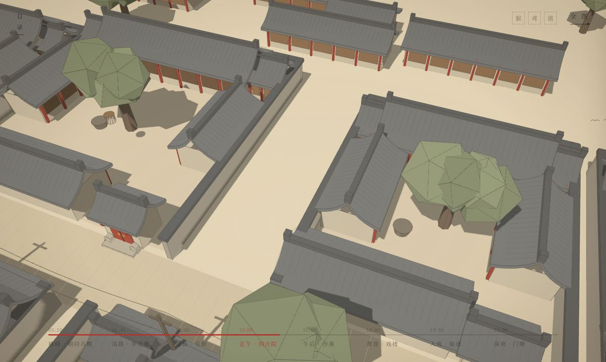
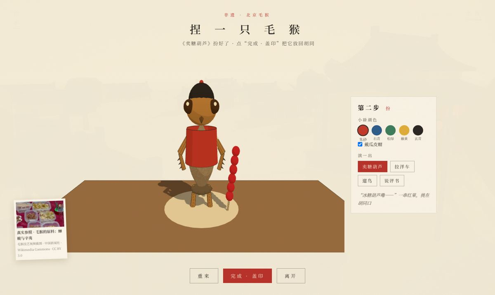

# 一日一巷：胡同里的时间遗产

> 一条胡同，一天时光，三项非遗。
> 从拂晓走到深夜，在北京胡同里亲手捏一只毛猴、放一只沙燕、勾一张脸谱。


这是一个以**北京胡同与非物质文化遗产**为主题的多模态交互网页。整条胡同用 3D 搭建，滚动一次，时间就往前走一段。镜头沿胡同从东头的清晨飞到西头的深夜，同一条街随时辰换光。途中的三项非遗都能亲手做一遍，做完的作品会留在胡同里。

---

## 体验流程

| 时间 | 场景 | 内容 |
|---|---|---|
| 05:30 拂晓 | 胡同口 | 首页：站在胡同口，轻滑一下走进去 |
| 06:45 清晨 | 早点摊 | 蒸笼热气、豆汁焦圈 |
| 08:30 清晨 | **毛猴工作台** | 🐒 非遗互动一：捏一只立体毛猴 |
| 12:00 正午 | 四合院 | 俯看院心，槐荫与鸟笼 |
| 15:00 午后 | **院墙上空** | 🪁 非遗互动二：绘一只沙燕，迎风放飞 |
| 18:00 黄昏 | 戏楼 | 锣鼓点起，夕阳落在飞檐 |
| 19:30 入夜 | **戏班后台** | 🎭 非遗互动三：对镜勾脸谱 |
| 23:00 深夜 | 门牌 | 集齐三枚印记，胡同记住了你 |

**操作**：滚轮、触控板或手指滑动一下，就切换到下一个时间点；也可以点底部时间轴跳转。画面上的红点可以点开，看场景故事或进入非遗互动。



---

## 三项非遗互动

### 🐒 北京毛猴：捏一只立体毛猴
毛猴是北京特有的民间工艺：**蝉蜕做头和四肢，辛夷花苞做身子**，用白芨胶粘起来，演出老北京的市井百态。
- **拼**：把 6 个 3D 零件拖到对应位置，粘合后可以拖动旋转查看
- **扮**：从五种传统色（朱砂、石青、松绿、藤黄、玄青）里选小褂颜色，可以戴瓜皮帽
- **演**：选一出市井戏，有卖糖葫芦、拉洋车、遛鸟、说评书四种
- 完成后，毛猴会摆回 3D 胡同的工作台上



### 🪁 沙燕风筝：先绘，再放
沙燕是北京风筝的代表，讲究“扎、糊、绘、放”四艺。
- **燕型**：胖沙燕（壮年男子）、瘦沙燕（年轻女子）、小沙燕（孩童）
- **纹样**：把蝙蝠（福）、寿桃（寿）、牡丹（贵）、盘长（绵长）拖到胸口、双膀或燕尾，左右会自动对称；两种纹样能组合出吉语，比如“福寿双全”
- **放飞**：按住鼠标或空格收线，松开放线。风会变，还有阵风，线拉太紧风筝会栽跟头。在稳飞区稳住 6 秒才算成功
- 成功后，你画的沙燕会飞在 3D 胡同的上空


### 🎭 京剧脸谱：对镜勾脸
- **摄像头模式**：用人脸识别把脸谱贴在你脸上，从额头往下一笔笔勾出来；张嘴就“亮相”，锣鼓声起；可以拍剧照保存
- **听戏文、认角色**：读一句戏文，从关羽（红）、张飞（黑）、曹操（白）、窦尔敦（蓝）里挑出对应的脸谱，了解“红忠勇、黑刚直、白奸诈、蓝桀骜”的色彩讲究
- **纸面具模式**：不开摄像头也能玩
- 隐私：摄像头画面只在本地浏览器里处理，不上传


---

## 本地运行

项目是纯静态网页，不需要安装依赖，也不需要打包。因为使用了 ES Module 和摄像头，需要通过本地服务器打开，直接双击 html 不行：

```bash
# 任选一种
python3 -m http.server 8000
npx serve .
```

然后访问 <http://localhost:8000>。

> 摄像头只能在 `localhost` 或 `https` 下调用。推荐使用桌面版 Chrome / Edge。

---

## 目录结构

```
├── index.html        页面骨架：首页、时间轴、面板、互动弹窗、结尾
├── style.css         样式：纸质底、朱砂红、首页分层、互动界面
├── main.js           主控：首页进入、一滑一站、时间与换光、热点、印记、结尾
├── scene.js          3D 胡同：程序化建模、镜头路线、昼夜光照、作品回写
├── games.js          三项非遗互动：毛猴 / 沙燕 / 脸谱 + 合成音效
├── img/              网页图片（首页分层、场景插画、脸谱、纹样、参考图）
├── lib/              第三方库（本地化，可离线运行）
│   ├── three.module.min.js, loaders/, utils/   Three.js
│   └── mp/                                       MediaPipe 人脸关键点
├── models/           Tripo AI 模型预留位（见 models/README.md）
└── docs/             README 截图
```

**常改的位置**
- 章节、热点文案：`main.js` 中的 `STOPS`、`SPOTS`
- 戏文、纹样、毛猴道具：`games.js` 中的 `ROLES`、`MOTIFS`、`MH_PROPS`
- 镜头机位、光照：`scene.js` 中的 `CAMS`、`LIGHT`
- 替换为 Tripo 模型：把 `.glb` 放进 `models/`，在 `models/manifest.json` 中登记即可自动替换

---

## 技术与设计

- **视觉**：米黄纸底 + 铅笔线稿 + 朱砂红点缀 + 北京蓝街牌；3D 场景用卡通渲染（Toon）加墨线描边，与手绘插画衔接
- **叙事**：参考 [Chartogne-Taillet](https://chartogne-taillet.com/fr) 的探索式漫游，一个世界承载全部叙事，用镜头飞行代替翻页，换光不换图
- **3D**：[Three.js](https://threejs.org/) 程序化建模胡同、四合院、戏楼、槐树、电线、鸽群
- **人脸**：[MediaPipe Face Landmarker](https://developers.google.com/mediapipe/solutions/vision/face_landmarker)，468 个关键点做仿射贴合，配合眼、口遮罩
- **声音**：Web Audio API 实时合成锣、鼓、风声，不需要音频文件
- **过渡**：首页 2D 插画与 3D 胡同同视角交叉溶解，由晨雾遮罩衔接

---

## 素材与致谢

- 首页、场景插画、脸谱与纹样贴图：AI 生成，再经人工挑选和处理
- 真实参照图（来自 Wikimedia Commons）：
  - 沙燕风筝：[Fengzheng.JPG](https://commons.wikimedia.org/wiki/File:Fengzheng.JPG) · CC BY-SA 3.0
  - 清代戏曲人物画：[Office of Great Peace Album of Opera Faces](https://commons.wikimedia.org/wiki/File:Office_of_Great_Peace_Album_of_Opera_Faces_1-05.jpg) · CC0
  - 毛猴技艺：中国新闻社视频截图 · CC BY 3.0
- 开源库：Three.js（MIT）、MediaPipe（Apache 2.0）

---

<sub>课程作业 · 北京胡同 × 非遗 × 多模态交互 · 舒舸</sub>
